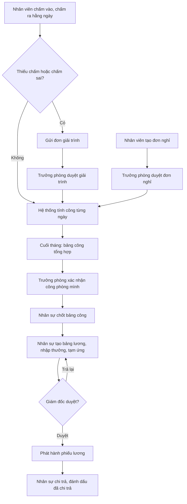
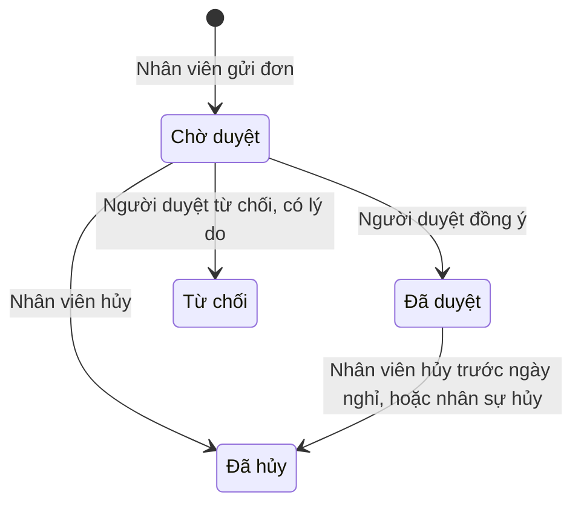
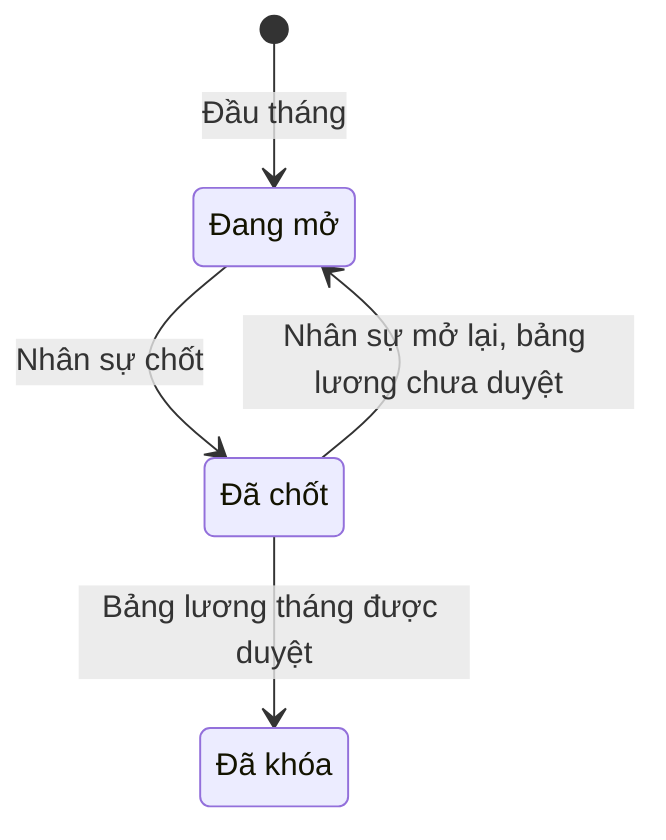
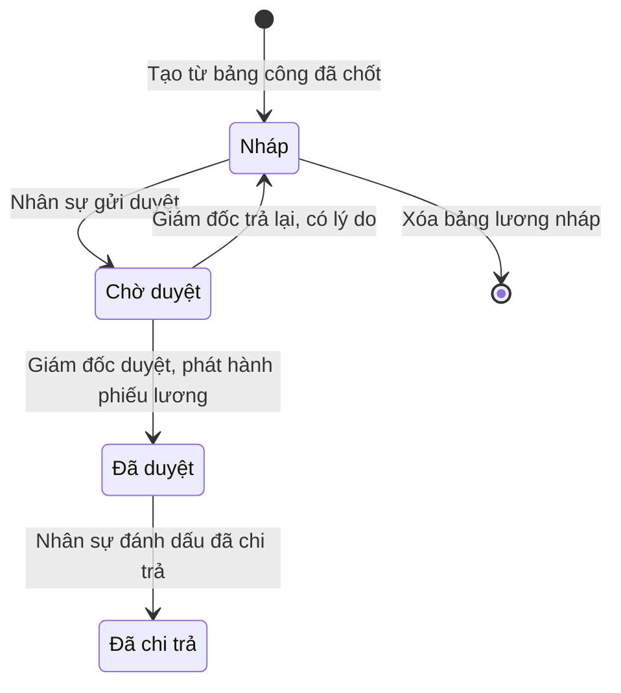
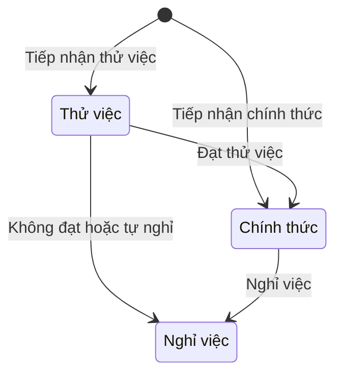

# Đặc tả yêu cầu phần mềm (SRS) — HRM Chấm công Tính lương

| Phiên bản | Ngày | Trạng thái |
| :--- | :--- | :--- |
| 1.0 | 12/10/2026 | Bản nháp để triển khai demo |

> Cách viết, quy ước mã, mức độ chi tiết: `ZDOCS/05-HUONG-DAN/HUONG-DAN-VIET-TAI-LIEU-NGHIEP-VU.md`.
> Phần nền (đăng nhập, tài khoản, vai trò, cài đặt, đặt lại dữ liệu demo): `ZDOCS/03-KIEN-TRUC/USE-CASE-NEN.md`, không viết lại ở đây.

---

## 1. Giới thiệu

### 1.1. Mục đích

Tài liệu mô tả đầy đủ yêu cầu của bản demo HRM Chấm công Tính lương: chức năng, quy tắc tính công, phép và lương, dữ liệu, báo cáo, phân quyền và màn hình. Dev dùng để code, tester dùng để viết và chạy test case, sales dùng để biết demo làm được gì.

### 1.2. Phạm vi

**Trong phạm vi:** phòng ban, hồ sơ nhân viên, hồ sơ lương và phụ cấp, ca làm, ngày lễ, chấm công trên điện thoại, nhập file máy chấm công, giải trình chấm công, đơn nghỉ và duyệt, quỹ phép năm, bảng công tháng, bảng lương tháng (lương theo ngày công, phụ cấp, bảo hiểm phần người lao động, thuế TNCN), duyệt bảng lương, phiếu lương, báo cáo nhân sự.

**Ngoài phạm vi:** kết nối máy chấm công thật (thay bằng nhập file), chấm công nhận diện khuôn mặt, làm thêm giờ, ca qua đêm, lương sản phẩm và hoa hồng tự tính, khai báo BHXH và thuế điện tử, chi trả chế độ ốm đau, thai sản (do BHXH chi trả), chuyển khoản lương thật, quyết toán thuế năm, nhiều pháp nhân hoặc chi nhánh.

> Bảng lương là bản demo đơn giản hóa. Tỉ lệ bảo hiểm, mức trần, giảm trừ gia cảnh, biểu thuế, lương tối thiểu vùng là **tham số cấu hình, giá trị mẫu**. Khi triển khai thật phải đối chiếu văn bản pháp luật hiện hành tại thời điểm tính lương.

### 1.3. Thuật ngữ

| Thuật ngữ | Giải thích |
| :--- | :--- |
| Ca làm | Khung giờ làm việc trong ngày: giờ vào, giờ ra, giờ nghỉ giữa ca, các thứ áp dụng trong tuần |
| Ca mặc định | Ca gán cho nhân viên, dùng để tính công từng ngày |
| Công | Đơn vị đo ngày làm việc; làm đủ một ca 8 giờ được 1 công |
| Công chuẩn | Số công nhân viên phải làm trong tháng theo lịch ca |
| Công thực tế | Tổng công tính từ dữ liệu chấm công trong tháng |
| Ngày công tính lương | Công thực tế cộng các ngày nghỉ có lương và ngày lễ |
| Ân hạn | Số phút sau giờ vào ca vẫn chưa tính đi muộn |
| Lần chấm | Một lần ghi nhận giờ của nhân viên, từ điện thoại, file máy chấm công hoặc do nhân sự sửa |
| Thiếu chấm công | Ngày làm việc có giờ vào mà không có giờ ra, hoặc ngược lại |
| Đơn giải trình | Đơn nhân viên gửi để bổ sung hoặc sửa giờ chấm của một ngày |
| Phép năm | Ngày nghỉ hưởng nguyên lương theo Bộ luật Lao động, tích lũy theo tháng |
| Quỹ phép | Số phép được hưởng, đã tích lũy, đã dùng, còn lại của một nhân viên trong năm |
| Bảng công | Tổng hợp công theo ngày và theo tháng của mọi nhân viên |
| Chốt bảng công | Khóa dữ liệu công của tháng để tính lương |
| Lương chính thức | Mức lương thỏa thuận khi nhân viên là chính thức |
| Lương đóng bảo hiểm | Mức lương làm căn cứ đóng BHXH, BHYT, BHTN |
| Tổng thu nhập | Lương theo công cộng phụ cấp, chuyên cần, khoản cộng (lương gross) |
| Thu nhập tính thuế | Thu nhập chịu thuế trừ bảo hiểm phần người lao động và giảm trừ gia cảnh |
| Thực lĩnh | Số tiền nhân viên nhận sau khi trừ bảo hiểm, thuế, khoản trừ (lương net) |
| Phiếu lương | Chi tiết lương của một nhân viên trong một tháng, nhân viên xem được sau khi bảng lương được duyệt |
| Tham số lương | Bộ giá trị cấu hình dùng khi tính lương: tỉ lệ bảo hiểm, trần, giảm trừ, biểu thuế, mức phụ cấp chung |

### 1.4. Tài liệu liên quan

| Tài liệu | Nội dung |
| :--- | :--- |
| `01-TONG-QUAN-NGHIEP-VU.md` | Tổng quan nghiệp vụ |
| `03-USE-CASE.md` | Đặc tả use case |
| `05-KICH-BAN-KIEM-THU.md` | Test case nghiệm thu |
| `ZDOCS/03-KIEN-TRUC/USE-CASE-NEN.md` | Phần nền dùng chung |

---

## 2. Mô tả tổng quan

### 2.1. Bối cảnh sản phẩm

Doanh nghiệp 20–300 nhân viên, có văn phòng và kho. Nhân viên văn phòng chấm công bằng điện thoại qua trình duyệt; bộ phận kho dùng máy chấm công vân tay, cuối tuần xuất file gửi nhân sự. Trưởng phòng duyệt đơn nghỉ trên điện thoại hoặc máy tính. Nhân sự tổng hợp công, tính lương trên máy tính; Giám đốc duyệt bảng lương. Bản demo chạy một công ty, 6 phòng ban, 60 nhân viên.

### 2.2. Tác nhân

| Mã vai trò | Tên | Thiết bị | Mục tiêu khi dùng hệ thống |
| :--- | :--- | :--- | :--- |
| `ADMIN` | Quản trị viên (đóng vai Giám đốc trong demo) | Desktop | Cấu hình hệ thống, phân quyền, duyệt bảng lương |
| `HR` | Nhân sự | Desktop | Hồ sơ, ca làm, theo dõi chấm công, chốt bảng công, tính lương không sai |
| `MANAGER` | Trưởng phòng | Desktop, điện thoại | Duyệt đơn nhanh, nắm ai đi muộn, ai nghỉ trong phòng, xác nhận công phòng mình |
| `STAFF` | Nhân viên | Điện thoại | Chấm công một chạm, xin nghỉ, xem công và phiếu lương của mình |

Tài khoản demo: `admin`, `nhansu`, `quanly`, `nhanvien`. Trưởng phòng và nhân sự cũng là nhân viên nên dùng được các chức năng "của tôi" (chấm công, xin nghỉ, xem phiếu lương). Tài khoản `admin` không gắn hồ sơ nhân viên. Bản triển khai nên tạo vai trò Giám đốc riêng (UC-SYS-06) và chuyển quyền `payrolls.approve` sang vai trò đó.

### 2.3. Quy trình nghiệp vụ

### 2.4. Giả định và ràng buộc

- Một công ty, một văn phòng; mỗi nhân viên có một ca mặc định tại mỗi thời điểm; ca bắt đầu và kết thúc trong cùng ngày.
- Chấm công trên điện thoại là chấm qua trình duyệt; giờ chấm lấy theo giờ máy chủ. Vị trí GPS chỉ lưu để tham khảo (P3), không chặn chấm.
- Máy chấm công thật không kết nối; nhân sự nhập file Excel/CSV theo mẫu thay thế.
- Lương tháng tính theo ngày công. Không có làm thêm giờ, lương sản phẩm; thưởng, hoa hồng nhập tay qua khoản cộng.
- Thay đổi lương, trạng thái nhân viên giữa tháng: bảng lương dùng giá trị hiệu lực tại ngày cuối tháng (đơn giản hóa).
- Mọi số tiền là VNĐ, làm tròn đến đồng; tiền lương, phụ cấp nhập là bội số của 1.000 ₫.
- Chi trả lương chỉ là đánh dấu trạng thái; không chuyển khoản thật.

---

## 3. Yêu cầu chức năng

### 3.1. Tổng quan

| Mã | Yêu cầu | Ưu tiên | Vai trò | UC |
| :--- | :--- | :---: | :--- | :--- |
| FR-01 | Hệ thống hiển thị số liệu hôm nay: nhân viên đang làm việc, đã chấm vào, đi muộn, nghỉ có đơn duyệt, chưa chấm công; danh sách đơn nghỉ và đơn giải trình đang chờ người dùng duyệt. Trưởng phòng chỉ thấy số liệu phòng mình | P1 | HR, MANAGER | UC-15 |
| FR-02 | Nhân viên đăng nhập thấy trang cá nhân: nút chấm công, giờ đã chấm hôm nay, công tháng này, số phép năm còn lại, phiếu lương mới nhất | P1 | STAFF | UC-15, UC-03 |

### 3.2. Tổ chức và hồ sơ nhân viên

| Mã | Yêu cầu | Ưu tiên | Vai trò | UC |
| :--- | :--- | :---: | :--- | :--- |
| FR-03 | Hệ thống cho phép nhân sự thêm, sửa, ngừng hoạt động phòng ban với mã, tên, trưởng phòng | P1 | HR | UC-01 |
| FR-04 | Hệ thống cho phép nhân sự thêm, sửa hồ sơ nhân viên: họ tên, giới tính, ngày sinh, CCCD, số điện thoại, email, phòng ban, chức danh, ngày vào làm, loại hợp đồng, trạng thái, ca mặc định, số người phụ thuộc, ngân hàng và số tài khoản | P1 | HR | UC-01 |
| FR-05 | Hệ thống cho phép nhân sự khai báo lương của nhân viên: lương chính thức, tỉ lệ lương thử việc, lương đóng bảo hiểm, các khoản phụ cấp cố định, có hưởng chuyên cần hay không | P1 | HR | UC-01 |
| FR-06 | Nhân sự và trưởng phòng tìm nhân viên theo mã, tên, lọc theo phòng ban, trạng thái; trưởng phòng chỉ thấy nhân viên phòng mình và không thấy thông tin lương | P1 | HR, MANAGER | UC-01 |
| FR-07 | Nhân sự chuyển nhân viên sang nghỉ việc với ngày nghỉ việc và lý do; tài khoản đăng nhập của nhân viên đó tự khóa sau ngày nghỉ việc | P2 | HR | UC-01 |
| FR-08 | Nhân sự tạo tài khoản đăng nhập vai trò `STAFF` cho nhân viên ngay từ hồ sơ, tên đăng nhập gợi ý theo email | P2 | HR | UC-01 |

### 3.3. Ca làm

| Mã | Yêu cầu | Ưu tiên | Vai trò | UC |
| :--- | :--- | :---: | :--- | :--- |
| FR-09 | Hệ thống cho phép nhân sự thêm, sửa ca làm: mã, tên, giờ vào, giờ ra, giờ nghỉ giữa ca, số công, các thứ áp dụng trong tuần, số phút ân hạn | P1 | HR | UC-02 |
| FR-10 | Nhân sự gán ca mặc định cho từng nhân viên hoặc hàng loạt theo phòng ban, có ngày áp dụng | P1 | HR | UC-02 |
| FR-11 | Nhân sự khai báo ngày nghỉ lễ trong năm; ngày lễ tự hiện ký hiệu `L` trên bảng công | P1 | HR | UC-02 |
| FR-12 | Nhân sự xếp lịch ca theo tuần khác ca mặc định cho từng nhân viên | P3 | HR | UC-02 |

### 3.4. Chấm công

| Mã | Yêu cầu | Ưu tiên | Vai trò | UC |
| :--- | :--- | :---: | :--- | :--- |
| FR-13 | Nhân viên chấm vào, chấm ra bằng một nút trên điện thoại; ngay sau khi chấm, hệ thống hiển thị giờ chấm, ca hôm nay, nhãn "Đúng giờ", "Đi muộn N phút" hoặc "Về sớm N phút" | P1 | STAFF | UC-03 |
| FR-14 | Nhân viên xem lịch công tháng của mình: mỗi ngày có giờ vào, giờ ra, công, ký hiệu nghỉ, đánh dấu ngày đi muộn, về sớm, thiếu chấm công | P1 | STAFF | UC-03 |
| FR-15 | Hệ thống lưu vị trí khi chấm (nếu trình duyệt cho phép) và gắn nhãn "Ngoài vị trí" khi cách văn phòng quá bán kính cấu hình, mặc định 200 m | P3 | STAFF | UC-03 |
| FR-16 | Nhân sự nhập file chấm công xuất từ máy chấm công (Excel hoặc CSV theo mẫu), xem trước, thấy dòng lỗi kèm lý do, nhập các dòng hợp lệ | P2 | HR | UC-04 |
| FR-17 | Nhân sự và trưởng phòng xem dữ liệu chấm công theo ngày hoặc khoảng ngày, lọc theo phòng ban và tình trạng (đúng giờ, đi muộn, về sớm, thiếu chấm công, vắng) | P1 | HR, MANAGER | UC-05 |
| FR-18 | Nhân sự sửa giờ vào, giờ ra của một ngày, bắt buộc nhập lý do; hệ thống tính lại công và lưu lịch sử sửa | P2 | HR | UC-05 |
| FR-19 | Nhân viên gửi đơn giải trình cho ngày thiếu chấm công hoặc chấm sai, đề xuất giờ vào, giờ ra và lý do; trưởng phòng duyệt hoặc từ chối | P2 | STAFF, MANAGER | UC-06 |

### 3.5. Nghỉ phép

| Mã | Yêu cầu | Ưu tiên | Vai trò | UC |
| :--- | :--- | :---: | :--- | :--- |
| FR-20 | Nhân viên tạo đơn nghỉ: loại nghỉ, từ ngày, đến ngày, cả ngày hoặc nửa ngày sáng/chiều, lý do; trước khi gửi, hệ thống hiển thị số ngày nghỉ của đơn và số phép năm còn lại | P1 | STAFF | UC-07 |
| FR-21 | Nhân viên xem danh sách đơn của mình theo trạng thái và hủy đơn theo BR-20 | P1 | STAFF | UC-07 |
| FR-22 | Trưởng phòng xem đơn chờ duyệt của phòng mình kèm lịch nghỉ của cả phòng trong khoảng ngày đó, duyệt hoặc từ chối có lý do; đơn của trưởng phòng do nhân sự duyệt | P1 | MANAGER, HR | UC-08 |
| FR-23 | Hệ thống tự cộng phép năm vào ngày 01 hằng tháng và tự hết hạn phép tồn năm trước theo BR-13, BR-14 | P1 | Hệ thống | UC-09, UC-07 |
| FR-24 | Nhân sự xem quỹ phép từng nhân viên (được hưởng, đã tích lũy, tồn năm trước, đã dùng, chờ duyệt, còn lại) và điều chỉnh có lý do | P2 | HR | UC-09 |

### 3.6. Bảng công

| Mã | Yêu cầu | Ưu tiên | Vai trò | UC |
| :--- | :--- | :---: | :--- | :--- |
| FR-25 | Hệ thống tổng hợp bảng công tháng: mỗi nhân viên một dòng, mỗi ngày một ô ký hiệu theo BR-21, các cột tổng; bấm vào ô mở chi tiết ngày (giờ chấm, phút muộn, sớm, đơn liên quan, lịch sử sửa) | P1 | HR, MANAGER | UC-10 |
| FR-26 | Trưởng phòng xác nhận bảng công tháng của phòng mình | P2 | MANAGER | UC-10 |
| FR-27 | Nhân sự chốt bảng công tháng theo BR-22; bảng công đã chốt không thay đổi được; nhân sự mở lại khi bảng lương tháng đó chưa duyệt | P1 | HR | UC-10 |
| FR-28 | Nhân sự xuất bảng công tháng ra file Excel | P2 | HR | UC-10 |

### 3.7. Bảng lương

| Mã | Yêu cầu | Ưu tiên | Vai trò | UC |
| :--- | :--- | :---: | :--- | :--- |
| FR-29 | Nhân sự cấu hình tham số lương có ngày hiệu lực: tỉ lệ bảo hiểm người lao động và doanh nghiệp, mức trần, lương tối thiểu vùng, giảm trừ gia cảnh, biểu thuế lũy tiến, mức ăn trưa một ngày, mức và điều kiện chuyên cần, danh mục phụ cấp (chịu thuế hay không) | P2 | HR | UC-11 |
| FR-30 | Nhân sự tạo bảng lương tháng từ bảng công đã chốt; hệ thống tính lương mọi nhân viên trong bảng công theo BR-23 đến BR-27 | P1 | HR | UC-12 |
| FR-31 | Nhân sự bấm vào từng số tiền trên dòng lương để xem công thức và giá trị đầu vào | P1 | HR | UC-12 |
| FR-32 | Nhân sự nhập khoản cộng (thưởng, hoa hồng) và khoản trừ (tạm ứng, truy thu) cho từng nhân viên, có ghi chú, đánh dấu chịu thuế hay không; hệ thống tính lại dòng ngay | P1 | HR | UC-12 |
| FR-33 | Nhân sự gửi duyệt bảng lương; Giám đốc xem tổng quỹ lương, tổng bảo hiểm người lao động và doanh nghiệp, tổng thuế, tổng thực lĩnh, so với tháng trước, rồi duyệt hoặc trả lại có lý do | P1 | HR, ADMIN | UC-13 |
| FR-34 | Nhân sự đánh dấu bảng lương đã chi trả kèm ngày chi trả | P2 | HR | UC-13 |

### 3.8. Phiếu lương

| Mã | Yêu cầu | Ưu tiên | Vai trò | UC |
| :--- | :--- | :---: | :--- | :--- |
| FR-35 | Khi bảng lương được duyệt, hệ thống phát hành phiếu lương; nhân viên xem phiếu lương của mình trên điện thoại: công chuẩn, ngày công tính lương, từng khoản thu nhập, bảo hiểm, thuế, khoản trừ, thực lĩnh | P1 | STAFF | UC-14 |
| FR-36 | Nhân viên và nhân sự in phiếu lương hoặc lưu PDF qua trình duyệt | P2 | STAFF, HR | UC-14 |
| FR-37 | Nhân viên gửi thắc mắc về phiếu lương; nhân sự trả lời ngay trên phiếu | P3 | STAFF, HR | UC-14 |

### 3.9. Báo cáo

| Mã | Yêu cầu | Ưu tiên | Vai trò | UC |
| :--- | :--- | :---: | :--- | :--- |
| FR-38 | Báo cáo nhân sự: số nhân viên theo phòng ban và trạng thái, vào mới, nghỉ việc theo tháng, tỉ lệ nghỉ việc | P2 | HR | UC-16 |
| FR-39 | Báo cáo chuyên cần: số lần và số phút đi muộn, về sớm, số ngày vắng, thiếu chấm công theo phòng ban và nhân viên | P2 | HR, MANAGER | UC-16 |
| FR-40 | Báo cáo quỹ lương theo tháng và phòng ban: tổng thu nhập, bảo hiểm phần người lao động và doanh nghiệp, thuế, thực lĩnh | P2 | HR, ADMIN | UC-16 |

---

## 4. Quy tắc nghiệp vụ

> Giá trị ghi "mẫu" là tham số cấu hình (FR-29). Khi triển khai thật phải đối chiếu quy định hiện hành.

### 4.1. Tổ chức, hồ sơ, ca làm

| Mã | Quy tắc | Áp dụng cho |
| :--- | :--- | :--- |
| BR-01 | Mã nhân viên `NV` + 4 số tăng dần, hệ thống tự cấp, không đổi khi chuyển phòng, không dùng lại. Mã phòng ban 2–10 chữ in hoa không dấu (`KD`, `HCNS`). CCCD đúng 12 chữ số, không trùng | FR-03, FR-04 |
| BR-02 | Mỗi nhân viên thuộc đúng một phòng ban. Mỗi phòng có tối đa một trưởng phòng, phải là nhân viên đang làm việc của phòng đó. Không ngừng hoạt động phòng ban còn nhân viên đang làm việc | FR-03, FR-04 |
| BR-03 | Trạng thái nhân viên: Thử việc, Chính thức, Nghỉ việc. Thời gian thử việc tối đa 60 ngày tính từ ngày vào làm (mẫu; luật quy định 6, 30, 60 hoặc 180 ngày tùy vị trí). Lương thử việc = lương chính thức × tỉ lệ thử việc; tỉ lệ từ 85% đến 100% | FR-04, FR-05 |
| BR-04 | Lương đóng bảo hiểm không thấp hơn lương tối thiểu vùng (mẫu vùng I: 5.310.000 ₫) và không cao hơn lương chính thức cộng phụ cấp cố định. Lương, phụ cấp là bội số của 1.000 ₫ | FR-05 |
| BR-05 | Ca làm: giờ ra sau giờ vào trong cùng ngày; giờ nghỉ giữa ca nằm trong ca; giờ chuẩn = (giờ ra − giờ vào) − thời gian nghỉ; ân hạn 0–30 phút. Nửa ca sáng tính từ giờ vào tới đầu giờ nghỉ, nửa ca chiều từ cuối giờ nghỉ tới giờ ra. Ca mẫu `HC`: 08:00–17:00, nghỉ 12:00–13:00, 8 giờ, 1 công, Thứ 2–Thứ 6, ân hạn 5 phút | FR-09 |
| BR-06 | Đổi ca mặc định có ngày áp dụng, không sớm hơn ngày đầu của tháng chưa chốt. Công chuẩn tháng = số ngày trong tháng là ngày làm việc theo ca áp dụng cho ngày đó, tính cả ngày lễ. Vd tháng 10/2026, ca `HC` (Thứ 2–Thứ 6): 22 công; ca Thứ 2–Thứ 7: 27 công | FR-10, FR-25 |

### 4.2. Chấm công

| Mã | Quy tắc | Áp dụng cho |
| :--- | :--- | :--- |
| BR-07 | Hệ thống nhận lần chấm trong khung từ giờ vào ca − 2 giờ đến giờ ra ca + 4 giờ (không quá 23:59). Ngoài khung: chấm trên điện thoại bị từ chối, dòng trong file bị báo lỗi. Giờ vào = lần chấm sớm nhất, giờ ra = lần chấm muộn nhất trong ngày. Ngày chỉ có một lần chấm: trước mốc giữa giờ nghỉ (12:30 với ca `HC`) là giờ vào, từ mốc đó trở đi là giờ ra. Các lần chấm cách nhau dưới 1 phút tính là một | FR-13, FR-16 |
| BR-08 | Đi muộn khi giờ vào > giờ vào ca + ân hạn; số phút muộn = giờ vào − giờ vào ca (vd 08:04 đúng giờ, 08:12 muộn 12 phút). Về sớm khi giờ ra < giờ ra ca; số phút sớm = giờ ra ca − giờ ra. Ngày có đơn nghỉ nửa ngày đã duyệt thì giờ vào, giờ ra ca lấy theo nửa ca còn lại | FR-13, FR-17 |
| BR-09 | Giờ làm thực tế = phần giao giữa [giờ vào, giờ ra] và [giờ vào ca, giờ ra ca], trừ phần trùng giờ nghỉ giữa ca; đến sớm, về muộn không tính thêm. Công ngày của ca 8 giờ: từ 7 giờ trở lên được 1 công; từ 4 giờ đến dưới 7 giờ được 0,5 công; dưới 4 giờ được 0 công (ngưỡng 7 và 4 là tham số). Ngày nghỉ nửa ngày có đơn duyệt: phần đi làm được 0,5 công nếu giờ làm thực tế từ 3 giờ 30 phút trở lên, ngược lại 0. Vd 08:12–17:00 làm 7 giờ 48 phút được 1 công; 08:00–15:30 làm 6 giờ 30 phút được 0,5 công | FR-13, FR-25 |
| BR-10 | Ngày làm việc chỉ có giờ vào hoặc chỉ có giờ ra: "Thiếu chấm công" (ký hiệu `?`), 0 công cho tới khi giải trình được duyệt hoặc nhân sự sửa. Ngày làm việc không có lần chấm, không có đơn nghỉ đã duyệt, không phải ngày lễ: "Vắng không phép" (`V`), 0 công. Ngày trước ngày vào làm hoặc sau ngày nghỉ việc để trống, không tính | FR-14, FR-25 |
| BR-11 | Lần chấm vào ngày nghỉ hằng tuần hoặc ngày lễ vẫn được lưu, gắn nhãn "Ngoài lịch làm việc", không tính công (làm thêm giờ ngoài phạm vi demo) | FR-13 |
| BR-12 | Đơn giải trình: tối đa 3 đơn mỗi nhân viên mỗi tháng; chỉ gửi cho ngày làm việc trong vòng 3 ngày làm việc trước hôm nay và thuộc tháng chưa chốt. Duyệt: giờ đề xuất thay giờ thiếu hoặc sai, công tính lại theo BR-09. Từ chối bắt buộc lý do. Nhân sự sửa công (FR-18) bắt buộc lý do, lưu giá trị trước và sau | FR-18, FR-19 |

### 4.3. Nghỉ phép

| Mã | Quy tắc | Áp dụng cho |
| :--- | :--- | :--- |
| BR-13 | Phép năm được hưởng = 12 ngày, cộng 1 ngày cho mỗi đủ 5 năm làm việc (mẫu, theo Điều 113, 114 Bộ luật Lao động 2019, điều kiện làm việc bình thường). Ngày 01 hằng tháng hệ thống cộng 1 ngày phép cho nhân viên đang làm việc; tháng vào làm được cộng nếu ngày vào làm từ ngày 15 trở về trước. Ngày phép thâm niên cộng một lần vào ngày 01/01 | FR-23 |
| BR-14 | Phép năm trước còn lại được dùng tới hết 31/03 năm sau (mẫu), sau đó hết hạn. Đơn phép năm trừ phép tồn năm trước trước, rồi mới trừ phép năm nay | FR-23, FR-24 |
| BR-15 | Phép khả dụng = phép tồn còn hạn + phép đã tích lũy năm nay + điều chỉnh − đã dùng − đang chờ duyệt. Đơn phép năm vượt phép khả dụng không gửi được (không ứng trước phép) | FR-20 |
| BR-16 | Số ngày của đơn = số ngày làm việc theo ca của nhân viên trong khoảng, không tính ngày nghỉ hằng tuần và ngày lễ; nửa ngày tính 0,5. Đơn tối thiểu 0,5 ngày. Đơn không được trùng ngày với đơn khác đang chờ duyệt hoặc đã duyệt. Vd Thứ 6 16/10/2026 đến Thứ 2 19/10/2026 là 2 ngày | FR-20 |
| BR-17 | Loại nghỉ và ký hiệu: Phép năm `P` (có lương, trừ phép); Việc riêng có lương `R` (kết hôn tối đa 3 ngày, con kết hôn 1 ngày, cha, mẹ, vợ, chồng, con mất 3 ngày); Nghỉ ốm `O` (công ty không trả lương, hưởng chế độ BHXH ngoài phạm vi, không trừ phép); Không lương `KL` (không trừ phép) | FR-20, FR-25 |
| BR-18 | Hạn gửi đơn: phép năm, việc riêng, không lương phải có ngày bắt đầu từ ngày mai trở đi; nghỉ ốm được gửi lùi tối đa 3 ngày làm việc. Không tạo đơn có ngày thuộc tháng đã chốt công | FR-20 |
| BR-19 | Người duyệt là trưởng phòng của nhân viên; đơn của trưởng phòng, hoặc phòng chưa có trưởng phòng, do nhân sự duyệt. Người duyệt không duyệt đơn của chính mình. Từ chối bắt buộc lý do. Duyệt thì số ngày chuyển từ "chờ duyệt" sang "đã dùng"; từ chối hoặc hủy thì trả lại phép khả dụng | FR-22, FR-19 |
| BR-20 | Nhân viên tự hủy đơn khi "Chờ duyệt", hoặc khi "Đã duyệt" mà ngày bắt đầu nghỉ chưa tới; hệ thống báo người duyệt. Đơn đã bắt đầu chỉ nhân sự hủy được, khi tháng đó chưa chốt công | FR-21 |

### 4.4. Bảng công

| Mã | Quy tắc | Áp dụng cho |
| :--- | :--- | :--- |
| BR-21 | Ô bảng công: `X` đủ 1 công, `0,5` nửa công, `P`, `R`, `O`, `KL` theo loại nghỉ, `L` ngày lễ, `V` vắng không phép, `?` thiếu chấm công, ngày nghỉ nửa ngày ghi hai ký hiệu (vd `P/X`), ô trống là ngày nghỉ hằng tuần hoặc ngoài thời gian làm việc; ngày đi muộn, về sớm có chấm màu cam. Ngày công tính lương = công thực tế + ngày `P` + ngày `R` + ngày `L` (lễ rơi vào ngày làm việc theo ca, trong thời gian làm việc của nhân viên). Không tính `O`, `KL`, `V`, `?`. Ngày có đơn nghỉ cả ngày đã duyệt mà vẫn có lần chấm: tính theo đơn nghỉ, lần chấm chỉ lưu tham khảo | FR-25, FR-30 |
| BR-22 | Chỉ nhân sự chốt bảng công. Không chốt được khi còn đơn nghỉ hoặc đơn giải trình "Chờ duyệt" có ngày trong tháng; hệ thống liệt kê để xử lý. Ngày thiếu chấm công và phòng chưa xác nhận chỉ cảnh báo; nhân sự xác nhận lần hai để chốt, ngày thiếu chấm công giữ 0 công. Bảng công đã chốt: không chấm bổ sung, không nhập file, không giải trình, không tạo, duyệt, hủy đơn có ngày trong tháng đó. Mở lại được khi bảng lương tháng đó chưa "Đã duyệt" | FR-26, FR-27 |

### 4.5. Lương

| Mã | Quy tắc | Áp dụng cho |
| :--- | :--- | :--- |
| BR-23 | Lương cơ bản tính lương: Chính thức = lương chính thức; Thử việc = lương chính thức × tỉ lệ thử việc. Lương theo công = lương cơ bản tính lương × ngày công tính lương ÷ công chuẩn. Vd 11.000.000 ₫ × 21 ÷ 22 = 10.500.000 ₫ | FR-30 |
| BR-24 | Phụ cấp ăn trưa = mức một ngày (mẫu 35.000 ₫) × số ngày có công thực tế > 0. Phụ cấp cố định tháng (điện thoại, xăng xe, trách nhiệm) = mức × ngày công tính lương ÷ công chuẩn. Chuyên cần (mẫu 500.000 ₫) chỉ cho nhân viên được bật, hưởng đủ khi trong tháng không có ngày `V` và tổng số lần đi muộn + về sớm không quá 3; ngược lại 0 ₫ | FR-30 |
| BR-25 | Bảo hiểm phần người lao động = lương đóng bảo hiểm × tỉ lệ (mẫu BHXH 8%, BHYT 1,5%, BHTN 1%, cộng 10,5%). Phần doanh nghiệp chỉ để báo cáo (mẫu BHXH 17,5% gồm quỹ tai nạn lao động, BHYT 3%, BHTN 1%, cộng 21,5%). Lương đóng BHXH, BHYT tối đa bằng trần (mẫu 46.800.000 ₫); BHTN tối đa trần riêng (mẫu 106.200.000 ₫). Không tính bảo hiểm cho nhân viên Thử việc, và cho tháng có từ 14 ngày làm việc trở lên không hưởng lương (`O`, `KL`, `V`). Kinh phí công đoàn không tính trong demo | FR-30 |
| BR-26 | Thu nhập chịu thuế = tổng thu nhập − các khoản không chịu thuế (đánh dấu trong danh mục phụ cấp; mẫu: ăn trưa). Thu nhập tính thuế = thu nhập chịu thuế − bảo hiểm người lao động − giảm trừ bản thân (mẫu 15.500.000 ₫) − giảm trừ người phụ thuộc (mẫu 6.200.000 ₫ mỗi người); âm thì bằng 0. Thuế TNCN tính lũy tiến từng phần theo biểu mẫu: đến 10.000.000 ₫: 5%; trên 10.000.000 đến 30.000.000 ₫: 10%; trên 30.000.000 đến 60.000.000 ₫: 20%; trên 60.000.000 đến 100.000.000 ₫: 30%; trên 100.000.000 ₫: 35%. Demo áp dụng cùng cách tính cho nhân viên thử việc (thực tế có trường hợp khấu trừ 10%, cần đối chiếu) | FR-30 |
| BR-27 | Tổng thu nhập = lương theo công + phụ cấp + chuyên cần + khoản cộng. Thực lĩnh = tổng thu nhập − bảo hiểm người lao động − thuế TNCN − khoản trừ. Mỗi khoản làm tròn đến đồng (từ 0,5 đồng làm tròn lên). Dòng có thực lĩnh âm bị đánh dấu lỗi | FR-30, FR-32 |
| BR-28 | Mỗi tháng một bảng lương, chỉ tạo khi bảng công tháng đó "Đã chốt"; gồm mọi nhân viên có trong bảng công. Chỉ ở trạng thái "Nháp" mới sửa khoản cộng, trừ và "Tính lại" (lấy hồ sơ lương, tham số hiện hành). Chỉ gửi duyệt khi không có dòng lỗi. Trả lại bắt buộc lý do. Duyệt thì phát hành phiếu lương và bảng công tháng đó chuyển "Đã khóa". Dòng lương lưu lại toàn bộ đầu vào tại thời điểm tính; sửa hồ sơ sau này không đổi phiếu lương đã phát hành | FR-30, FR-32, FR-33, FR-35 |

### 4.6. Phạm vi dữ liệu và chứng từ

| Mã | Quy tắc | Áp dụng cho |
| :--- | :--- | :--- |
| BR-29 | Nhân viên chỉ xem dữ liệu của mình. Trưởng phòng xem hồ sơ (không gồm lương), chấm công, đơn, bảng công của phòng mình. Nhân sự và quản trị viên xem toàn công ty. Phiếu lương chỉ hiện với chính nhân viên sau khi phát hành và với người có quyền `payslips.view-all` | FR-01, FR-06, FR-17, FR-35 |
| BR-30 | Mã chứng từ theo §5.3 | FR-20, FR-19, FR-30, FR-35 |
| BR-31 | Nhân viên nghỉ việc: từ ngày sau ngày nghỉ việc không chấm công được, không tính công, tài khoản đăng nhập bị khóa (BR-SYS-04); vẫn có dòng trong bảng lương tháng nghỉ việc. Phép năm còn lại hiển thị để nhân sự xử lý thanh toán (ngoài phạm vi demo) | FR-07 |

---

## 5. Yêu cầu dữ liệu

### 5.1. Thực thể

| Thực thể | Mô tả | Thuộc tính chính | Quan hệ |
| :--- | :--- | :--- | :--- |
| Phòng ban | Đơn vị tổ chức | Mã, tên, trưởng phòng, trạng thái | Có nhiều nhân viên |
| Nhân viên | Hồ sơ người lao động | Mã, họ tên, giới tính, ngày sinh, CCCD, số điện thoại, email, chức danh, ngày vào làm, loại hợp đồng, trạng thái, ngày nghỉ việc, số người phụ thuộc, ngân hàng, số tài khoản | Thuộc một phòng ban; gắn tối đa một tài khoản đăng nhập; có một hồ sơ lương; có lịch sử ca mặc định |
| Hồ sơ lương | Lương hiện hành của nhân viên | Lương chính thức, tỉ lệ thử việc, lương đóng bảo hiểm, hưởng chuyên cần, ngày hiệu lực | Thuộc một nhân viên; có nhiều phụ cấp nhân viên |
| Loại phụ cấp | Danh mục phụ cấp | Tên, cách tính (theo ngày đi làm hoặc theo tháng tỉ lệ công), chịu thuế | Dùng trong nhiều phụ cấp nhân viên |
| Phụ cấp nhân viên | Mức phụ cấp của một người | Loại phụ cấp, mức tiền | Thuộc một hồ sơ lương |
| Ca làm | Khung giờ làm việc | Mã, tên, giờ vào, giờ ra, nghỉ từ, nghỉ đến, số công, thứ áp dụng, phút ân hạn | Gán cho nhiều nhân viên |
| Lịch sử ca | Ca mặc định theo thời gian | Nhân viên, ca, áp dụng từ ngày | Thuộc một nhân viên |
| Ngày lễ | Ngày nghỉ hưởng lương chung | Ngày, tên | — |
| Lần chấm | Một lần ghi nhận giờ | Nhân viên, thời điểm, nguồn (điện thoại, file, nhân sự sửa), vị trí, nhãn ngoài vị trí | Thuộc một nhân viên |
| Ngày công | Kết quả tính công của một ngày | Nhân viên, ngày, ca, giờ vào, giờ ra, phút muộn, phút sớm, giờ làm thực tế, công, ký hiệu, ghi chú sửa | Tính từ lần chấm, đơn nghỉ, đơn giải trình, ngày lễ |
| Đơn giải trình | Đề nghị sửa giờ chấm | Mã, nhân viên, ngày, giờ vào đề xuất, giờ ra đề xuất, lý do, trạng thái, người duyệt, lý do từ chối | Thuộc một nhân viên; tác động một ngày công |
| Loại nghỉ | Danh mục loại nghỉ | Mã (`P`, `R`, `O`, `KL`), tên, có lương, trừ phép, số ngày tối đa mỗi đơn | Dùng trong nhiều đơn nghỉ |
| Đơn nghỉ | Đơn xin nghỉ | Mã, nhân viên, loại nghỉ, từ ngày, đến ngày, buổi (cả ngày, sáng, chiều), số ngày, lý do, trạng thái, người duyệt, thời điểm duyệt, lý do từ chối | Thuộc một nhân viên |
| Quỹ phép năm | Phép của một người trong một năm | Nhân viên, năm, được hưởng, đã tích lũy, tồn năm trước, hạn dùng tồn, điều chỉnh, đã dùng, chờ duyệt | Thuộc một nhân viên; có lịch sử điều chỉnh |
| Bảng công tháng | Kỳ công | Tháng, trạng thái, người chốt, thời điểm chốt | Có nhiều ngày công; có xác nhận của từng phòng |
| Xác nhận công phòng | Trưởng phòng xác nhận | Phòng ban, tháng, người xác nhận, thời điểm | Thuộc một bảng công tháng |
| Tham số lương | Bộ giá trị tính lương | Ngày hiệu lực, tỉ lệ bảo hiểm, trần, lương tối thiểu vùng, giảm trừ, biểu thuế, ăn trưa một ngày, mức chuyên cần, ngưỡng mất chuyên cần | — |
| Bảng lương | Bảng lương của một tháng | Mã, tháng, trạng thái, tổng thu nhập, tổng bảo hiểm, tổng thuế, tổng thực lĩnh, người duyệt, lý do trả lại, ngày chi trả | Dựa trên một bảng công đã chốt; có nhiều dòng lương |
| Dòng lương | Lương một nhân viên trong tháng, cũng là phiếu lương | Mã phiếu, nhân viên, công chuẩn, ngày công tính lương, lương cơ bản tính lương, lương theo công, phụ cấp, chuyên cần, khoản cộng, tổng thu nhập, bảo hiểm, thu nhập chịu thuế, giảm trừ, thu nhập tính thuế, thuế, khoản trừ, thực lĩnh, ảnh chụp đầu vào | Thuộc một bảng lương; có nhiều khoản cộng, trừ |
| Khoản cộng, trừ | Thưởng, tạm ứng, truy thu | Loại (cộng, trừ), tên, số tiền, chịu thuế, ghi chú | Thuộc một dòng lương |

### 5.2. Vòng đời

**Đơn nghỉ**

**Bảng công tháng**

Xác nhận của trưởng phòng là cờ theo từng phòng trong tháng "Đang mở", không phải trạng thái của bảng công.

**Bảng lương**

**Nhân viên**

**Đơn giải trình:** Chờ duyệt → Đã duyệt hoặc Từ chối (có lý do); nhân viên hủy được khi còn Chờ duyệt.

### 5.3. Mã chứng từ

| Chứng từ | Định dạng | Ví dụ |
| :--- | :--- | :--- |
| Nhân viên | `NV` + 4 số | `NV0025` |
| Đơn nghỉ | `NP` + `yyMMdd` (ngày tạo) + 3 số | `NP261012001` |
| Đơn giải trình | `GT` + `yyMMdd` (ngày tạo) + 3 số | `GT261012001` |
| Bảng lương | `BL` + `yyMM` | `BL2609` |
| Phiếu lương | `PL` + `yyMM` + mã nhân viên | `PL2609NV0025` |
| Ca làm | 2–6 chữ in hoa và số | `HC`, `KHO` |

---

## 6. Báo cáo

| Báo cáo | Chỉ số | Bộ lọc | Vai trò |
| :--- | :--- | :--- | :--- |
| Tổng quan hôm nay | Đang làm việc, đã chấm vào, đi muộn, nghỉ có đơn, chưa chấm công, đơn chờ duyệt | — | HR, MANAGER (phòng mình) |
| Nhân sự | Số nhân viên theo phòng ban, trạng thái; vào mới, nghỉ việc; tỉ lệ nghỉ việc tháng = số nghỉ việc ÷ ((đầu tháng + cuối tháng) ÷ 2) × 100% | Tháng, phòng ban | HR |
| Chuyên cần | Số lần, số phút đi muộn, về sớm; số ngày vắng, thiếu chấm công; top 10 nhân viên đi muộn | Khoảng ngày, phòng ban | HR, MANAGER (phòng mình) |
| Nghỉ phép | Phép được hưởng, đã dùng, còn lại; số ngày nghỉ theo loại | Năm, phòng ban | HR |
| Quỹ lương | Tổng thu nhập, bảo hiểm người lao động và doanh nghiệp, thuế, thực lĩnh theo tháng và phòng ban | Khoảng tháng, phòng ban | HR, ADMIN |

---

## 7. Phân quyền

> Quyền nền (`dashboard`, `users`, `roles`, `settings`, `audit-logs`) xem `USE-CASE-NEN.md` §7. Quyền "của mình" chỉ có tác dụng khi tài khoản gắn hồ sơ nhân viên.

| Mã quyền | Mô tả | ADMIN | HR | MANAGER | STAFF |
| :--- | :--- | :---: | :---: | :---: | :---: |
| `departments.view` | Xem phòng ban | ✓ | ✓ | ✓ | |
| `departments.create` / `update` / `delete` | Quản lý phòng ban | ✓ | ✓ | | |
| `employees.view` | Xem hồ sơ nhân viên (trưởng phòng: phòng mình) | ✓ | ✓ | ✓ | |
| `employees.create` / `update` / `delete` | Thêm, sửa, cho nghỉ việc, tạo tài khoản | ✓ | ✓ | | |
| `employees.salary` | Xem, sửa lương và phụ cấp | ✓ | ✓ | | |
| `shifts.view` | Xem ca làm, ngày lễ | ✓ | ✓ | ✓ | ✓ |
| `shifts.create` / `update` / `delete` | Quản lý ca, ngày lễ, gán ca | ✓ | ✓ | | |
| `attendance-records.check-in` | Chấm công, xem lịch công của mình | ✓ | ✓ | ✓ | ✓ |
| `attendance-records.view` | Xem chấm công người khác (trưởng phòng: phòng mình) | ✓ | ✓ | ✓ | |
| `attendance-records.update` | Sửa giờ chấm, công | ✓ | ✓ | | |
| `attendance-records.import` | Nhập file máy chấm công | ✓ | ✓ | | |
| `attendance-explanations.create` | Gửi, hủy đơn giải trình của mình | ✓ | ✓ | ✓ | ✓ |
| `attendance-explanations.approve` | Duyệt, từ chối đơn giải trình | ✓ | ✓ | ✓ | |
| `leave-requests.create` | Tạo, hủy đơn nghỉ của mình | ✓ | ✓ | ✓ | ✓ |
| `leave-requests.view` | Xem đơn của người khác | ✓ | ✓ | ✓ | |
| `leave-requests.approve` | Duyệt, từ chối đơn nghỉ | ✓ | ✓ | ✓ | |
| `leave-requests.cancel` | Hủy đơn đã bắt đầu | ✓ | ✓ | | |
| `leave-balances.view` / `update` | Xem, điều chỉnh quỹ phép mọi người | ✓ | ✓ | | |
| `timesheets.view` | Xem, xuất bảng công (trưởng phòng: phòng mình) | ✓ | ✓ | ✓ | |
| `timesheets.confirm` | Xác nhận bảng công phòng mình | ✓ | | ✓ | |
| `timesheets.lock` | Chốt, mở lại bảng công | ✓ | ✓ | | |
| `payrolls.view` | Xem bảng lương | ✓ | ✓ | | |
| `payrolls.create` / `update` | Tạo, tính lại, nhập khoản cộng trừ, gửi duyệt | ✓ | ✓ | | |
| `payrolls.approve` | Duyệt, trả lại bảng lương | ✓ | | | |
| `payrolls.pay` | Đánh dấu đã chi trả | ✓ | ✓ | | |
| `payroll-settings.view` / `update` | Xem, sửa tham số lương | ✓ | ✓ | | |
| `payslips.view` | Xem phiếu lương của mình | ✓ | ✓ | ✓ | ✓ |
| `payslips.view-all` | Xem phiếu lương mọi người | ✓ | ✓ | | |
| `reports.view` | Xem báo cáo (trưởng phòng: chỉ tab Chuyên cần của phòng mình) | ✓ | ✓ | ✓ | |

---

## 8. Yêu cầu phi chức năng

> Yêu cầu chung (bảo mật JWT, phân quyền, tiếng Việt, chế độ dữ liệu mẫu) theo `ZDOCS/03-KIEN-TRUC/KIEN-TRUC-HE-THONG.md`. Ở đây chỉ ghi yêu cầu riêng của dự án.

| Mã | Yêu cầu |
| :--- | :--- |
| NFR-01 | Trang cá nhân và màn chấm công tối ưu cho điện thoại rộng 360–430 px: nút chấm công cao tối thiểu 64 px, nằm trong màn hình đầu, không cần cuộn; chấm xong hiển thị kết quả dưới 2 giây |
| NFR-02 | Ở chế độ `api`, giờ chấm lấy theo giờ máy chủ múi giờ UTC+7, không lấy giờ điện thoại; chế độ `mock` dùng giờ trình duyệt |
| NFR-03 | Bảng công 60 nhân viên × 31 ngày hiển thị dưới 2 giây; cột mã và tên cố định khi cuộn ngang; mỗi ô có chú thích khi rê chuột |
| NFR-04 | Tính bảng lương 60 nhân viên dưới 5 giây; mọi phép tính tiền dùng kiểu số thập phân (`decimal`), không dùng số thực dấu phẩy động |
| NFR-05 | API lương, phiếu lương kiểm tra quyền và chủ sở hữu ở máy chủ; đổi ID trên URL không xem được phiếu của người khác. CCCD, số tài khoản ngân hàng che bớt trên danh sách (vd `0790****1234`) |
| NFR-06 | Sửa công, duyệt đơn, chốt và mở lại bảng công, sửa lương, duyệt bảng lương đều ghi nhật ký kèm giá trị trước và sau (FR-SYS-10) |
| NFR-07 | Dữ liệu mẫu có 60 nhân viên, 3 tháng chấm công tính tới hôm qua với khoảng 5% lượt đi muộn, 2% về sớm, 1% thiếu chấm công; 80 đơn nghỉ đủ trạng thái; bảng lương 2 tháng trước "Đã chi trả", bảng công tháng trước "Đang mở" |

---

## 9. Danh sách màn hình

| Mã | Màn hình | Route | Vai trò | Thiết bị | UC |
| :--- | :--- | :--- | :--- | :--- | :--- |
| SCR-01 | Tổng quan | `/dashboard` | ADMIN, HR, MANAGER | Desktop | UC-15 |
| SCR-02 | Trang cá nhân nhân viên | `/dashboard` (giao diện nhân viên) | STAFF | Điện thoại | UC-03, UC-15 |
| SCR-03 | Phòng ban | `/departments` | HR | Desktop | UC-01 |
| SCR-04 | Danh sách nhân viên | `/employees` | HR, MANAGER | Desktop | UC-01 |
| SCR-05 | Hồ sơ nhân viên (tab Thông tin, Lương và phụ cấp, Phép, Chấm công) | `/employees/[id]` | HR, MANAGER (không có tab Lương) | Desktop | UC-01, UC-09 |
| SCR-06 | Ca làm và ngày lễ | `/shifts` | HR | Desktop | UC-02 |
| SCR-07 | Chấm công của tôi (nút chấm, lịch công tháng) | `/attendance` | STAFF, MANAGER, HR | Điện thoại | UC-03 |
| SCR-08 | Dữ liệu chấm công | `/attendance/records` | HR, MANAGER | Desktop | UC-05 |
| SCR-09 | Nhập file chấm công | `/attendance/import` | HR | Desktop | UC-04 |
| SCR-10 | Đơn giải trình | `/attendance/explanations` | STAFF, MANAGER, HR | Điện thoại, desktop | UC-06 |
| SCR-11 | Đơn nghỉ (tab Của tôi, Chờ tôi duyệt, Tất cả, Quỹ phép) | `/leaves` | STAFF, MANAGER, HR | Điện thoại, desktop | UC-07, UC-08, UC-09 |
| SCR-12 | Bảng công tháng | `/timesheets` | HR, MANAGER | Desktop | UC-10 |
| SCR-13 | Danh sách bảng lương | `/payrolls` | HR, ADMIN | Desktop | UC-12, UC-13 |
| SCR-14 | Chi tiết bảng lương | `/payrolls/[id]` | HR, ADMIN | Desktop | UC-12, UC-13 |
| SCR-15 | Tham số lương | `/payrolls/settings` | HR | Desktop | UC-11 |
| SCR-16 | Phiếu lương | `/payslips` | STAFF, HR | Điện thoại, desktop | UC-14 |
| SCR-17 | Bản in phiếu lương | `/payslips/[id]` | STAFF, HR | Khổ A5, PDF | UC-14 |
| SCR-18 | Báo cáo nhân sự | `/reports` | HR, ADMIN, MANAGER | Desktop | UC-16 |
