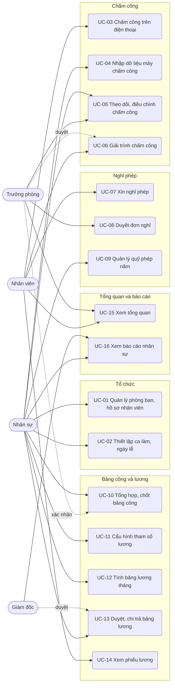

# Đặc tả use case — HRM Chấm công Tính lương

> Use case phần nền (UC-SYS-01 đến UC-SYS-10): `ZDOCS/03-KIEN-TRUC/USE-CASE-NEN.md`.
> Mã FR, BR, SCR tham chiếu `02-SRS.md`.

---

## 1. Tác nhân

| Tác nhân | Mã vai trò | Use case chính |
| :--- | :--- | :--- |
| Nhân viên | `STAFF` | UC-03, UC-06, UC-07, UC-14, UC-15 |
| Trưởng phòng | `MANAGER` | UC-05 (xem), UC-06 (duyệt), UC-08, UC-10 (xác nhận), UC-15, UC-16 (chuyên cần); cộng các UC của nhân viên cho bản thân |
| Nhân sự | `HR` | UC-01, UC-02, UC-04, UC-05, UC-08 (đơn của trưởng phòng), UC-09, UC-10, UC-11, UC-12, UC-13 (gửi duyệt, chi trả), UC-15, UC-16; cộng các UC của nhân viên cho bản thân |
| Giám đốc | `ADMIN` (tài khoản `admin`) | UC-13 (duyệt), UC-16; toàn bộ, cộng phần nền |
| Hệ thống | — | UC-09 (cộng phép hằng tháng) |

---

## 2. Sơ đồ use case

---

## 3. Danh sách use case

| Mã | Tên | Tác nhân chính | Module | Ưu tiên | FR |
| :--- | :--- | :--- | :--- | :---: | :--- |
| UC-01 | Quản lý phòng ban và hồ sơ nhân viên | Nhân sự | Tổ chức | P1 | FR-03, FR-04, FR-05, FR-06, FR-07, FR-08 |
| UC-02 | Thiết lập ca làm và ngày lễ | Nhân sự | Tổ chức | P1 | FR-09, FR-10, FR-11, FR-12 |
| UC-03 | Chấm công trên điện thoại | Nhân viên | Chấm công | P1 | FR-02, FR-13, FR-14, FR-15 |
| UC-04 | Nhập dữ liệu máy chấm công | Nhân sự | Chấm công | P2 | FR-16 |
| UC-05 | Theo dõi và điều chỉnh chấm công | Nhân sự, Trưởng phòng | Chấm công | P1 | FR-17, FR-18 |
| UC-06 | Giải trình chấm công | Nhân viên, Trưởng phòng | Chấm công | P2 | FR-19 |
| UC-07 | Xin nghỉ phép | Nhân viên | Nghỉ phép | P1 | FR-20, FR-21, FR-23 |
| UC-08 | Duyệt đơn nghỉ | Trưởng phòng, Nhân sự | Nghỉ phép | P1 | FR-22 |
| UC-09 | Quản lý quỹ phép năm | Nhân sự, Hệ thống | Nghỉ phép | P2 | FR-23, FR-24 |
| UC-10 | Tổng hợp và chốt bảng công | Nhân sự, Trưởng phòng | Bảng công và lương | P1 | FR-25, FR-26, FR-27, FR-28 |
| UC-11 | Cấu hình tham số lương | Nhân sự | Bảng công và lương | P2 | FR-29 |
| UC-12 | Tính bảng lương tháng | Nhân sự | Bảng công và lương | P1 | FR-30, FR-31, FR-32 |
| UC-13 | Duyệt và chi trả bảng lương | Giám đốc, Nhân sự | Bảng công và lương | P1 | FR-33, FR-34 |
| UC-14 | Xem phiếu lương | Nhân viên | Bảng công và lương | P1 | FR-35, FR-36, FR-37 |
| UC-15 | Xem tổng quan | Nhân sự, Trưởng phòng, Nhân viên | Tổng quan và báo cáo | P1 | FR-01, FR-02 |
| UC-16 | Xem báo cáo nhân sự | Nhân sự, Giám đốc | Tổng quan và báo cáo | P2 | FR-38, FR-39, FR-40 |

---

## 4. Đặc tả chi tiết

### UC-01: Quản lý phòng ban và hồ sơ nhân viên

| Mục | Nội dung |
| :--- | :--- |
| Tác nhân chính | Nhân sự |
| Tác nhân phụ | Trưởng phòng (chỉ xem phòng mình) |
| Mô tả | Khai báo phòng ban, hồ sơ, lương, phụ cấp của nhân viên; cho nhân viên nghỉ việc |
| Ưu tiên | P1 |
| Điều kiện kích hoạt | Có nhân viên mới, đổi phòng, tăng lương, nghỉ việc |
| Tiền điều kiện | Có quyền `employees.create` hoặc `employees.update`; sửa lương cần `employees.salary` |
| Hậu điều kiện | Hồ sơ được lưu; nhân viên mới xuất hiện ở bảng công từ ngày vào làm |
| Yêu cầu liên quan | FR-03 đến FR-08, BR-01 đến BR-04, BR-29, BR-31 |
| Màn hình | SCR-03, SCR-04, SCR-05 |

**Luồng chính (thêm nhân viên)**

1. Nhân sự mở Nhân viên; hệ thống hiển thị danh sách có mã, họ tên, phòng ban, chức danh, ngày vào làm, trạng thái; tìm theo mã, tên, lọc theo phòng ban, trạng thái.
2. Bấm "Thêm nhân viên"; nhập thông tin cá nhân (họ tên, giới tính, ngày sinh, CCCD, số điện thoại, email).
3. Nhập thông tin công việc: phòng ban, chức danh, ngày vào làm, loại hợp đồng, trạng thái (Thử việc hoặc Chính thức), ca mặc định, số người phụ thuộc, ngân hàng, số tài khoản.
4. Mở tab Lương và phụ cấp: nhập lương chính thức, tỉ lệ thử việc (mặc định 85%), lương đóng bảo hiểm, thêm các phụ cấp cố định, bật hoặc tắt chuyên cần. Hệ thống hiển thị lương cơ bản tính lương theo BR-23.
5. Bấm "Lưu"; hệ thống kiểm tra BR-01 đến BR-04, cấp mã `NV` + 4 số, hiển thị hồ sơ.

**Luồng thay thế**

- 1a. Quản lý phòng ban: mở Phòng ban, thêm hoặc sửa mã, tên, chọn trưởng phòng trong số nhân viên của phòng; bật/tắt hoạt động.
- 1b. Trưởng phòng mở Nhân viên: chỉ thấy nhân viên phòng mình, hồ sơ không có tab Lương và phụ cấp (BR-29).
- 5a. Tạo tài khoản đăng nhập: trong hồ sơ bấm "Tạo tài khoản", hệ thống gợi ý tên đăng nhập theo phần trước `@` của email, vai trò `STAFF` (FR-08).
- 5b. Cho nghỉ việc: bấm "Nghỉ việc", nhập ngày nghỉ việc, lý do; hệ thống chuyển trạng thái, khóa tài khoản sau ngày nghỉ việc (BR-31).

**Luồng ngoại lệ**

- E1. CCCD không đủ 12 số hoặc đã có: báo lỗi tại ô CCCD.
- E2. Tỉ lệ thử việc dưới 85%: báo "Lương thử việc tối thiểu 85% lương chính thức".
- E3. Lương đóng bảo hiểm thấp hơn lương tối thiểu vùng: báo "Lương đóng bảo hiểm không thấp hơn 5.310.000 ₫" (giá trị theo tham số).
- E4. Ngừng hoạt động phòng ban còn nhân viên đang làm việc: từ chối, nêu số nhân viên còn lại.

### UC-02: Thiết lập ca làm và ngày lễ

| Mục | Nội dung |
| :--- | :--- |
| Tác nhân chính | Nhân sự |
| Mô tả | Khai báo ca làm, gán ca cho nhân viên, khai báo ngày lễ trong năm |
| Ưu tiên | P1 |
| Điều kiện kích hoạt | Đầu năm, có bộ phận làm ca mới, đổi giờ làm |
| Tiền điều kiện | Có quyền `shifts.create` hoặc `shifts.update` |
| Hậu điều kiện | Công chuẩn và cách tính công các ngày từ ngày áp dụng dùng ca mới |
| Yêu cầu liên quan | FR-09 đến FR-12, BR-05, BR-06 |
| Màn hình | SCR-06, SCR-05 |

**Luồng chính (thêm ca)**

1. Nhân sự mở Ca làm; hệ thống hiển thị danh sách ca kèm giờ vào, giờ ra, giờ chuẩn, thứ áp dụng, số nhân viên đang dùng.
2. Bấm "Thêm ca"; nhập mã, tên, giờ vào, giờ ra, giờ nghỉ từ–đến, số công, chọn các thứ áp dụng, số phút ân hạn.
3. Hệ thống tính và hiển thị giờ chuẩn, công chuẩn tháng hiện tại theo BR-06.
4. Bấm "Lưu"; ca xuất hiện trong danh sách.

**Luồng thay thế**

- 1a. Gán ca: chọn ca, bấm "Gán cho nhân viên", chọn từng người hoặc cả phòng ban, chọn ngày áp dụng, lưu.
- 1b. Ngày lễ: mở tab Ngày lễ, chọn năm, thêm ngày và tên (vd 01/09/2026, 02/09/2026 Quốc khánh); ngày lễ hiện `L` trên bảng công.
- 1c. Xếp lịch ca theo tuần khác ca mặc định (P3).

**Luồng ngoại lệ**

- E1. Giờ ra không sau giờ vào, hoặc giờ nghỉ nằm ngoài ca: báo lỗi, không lưu.
- E2. Ngày áp dụng gán ca thuộc tháng đã chốt công: báo "Tháng đã chốt công, chọn ngày từ tháng chưa chốt".
- E3. Xóa ca đang gán cho nhân viên: từ chối, gợi ý gán ca khác trước.

### UC-03: Chấm công trên điện thoại

| Mục | Nội dung |
| :--- | :--- |
| Tác nhân chính | Nhân viên |
| Mô tả | Chấm vào, chấm ra một chạm và xem lịch công tháng của mình |
| Ưu tiên | P1 |
| Điều kiện kích hoạt | Nhân viên tới văn phòng hoặc ra về |
| Tiền điều kiện | Tài khoản gắn hồ sơ nhân viên đang làm việc; có quyền `attendance-records.check-in` |
| Hậu điều kiện | Lần chấm được lưu; ngày công hôm nay tính lại theo BR-07 đến BR-09 |
| Yêu cầu liên quan | FR-02, FR-13, FR-14, FR-15, BR-07 đến BR-11 |
| Màn hình | SCR-02, SCR-07 |

**Luồng chính**

1. Nhân viên mở ứng dụng trên điện thoại; hệ thống hiển thị trang cá nhân: ca hôm nay (vd "Hành chính 08:00–17:00"), giờ hiện tại, nút lớn "Chấm vào".
2. Nhân viên bấm "Chấm vào"; hệ thống ghi giờ theo máy chủ, kèm vị trí nếu trình duyệt cho phép.
3. Hệ thống hiển thị giờ vào và nhãn "Đúng giờ" hoặc "Đi muộn N phút" (BR-08); nút đổi thành "Chấm ra".
4. Cuối ngày nhân viên bấm "Chấm ra"; hệ thống ghi giờ ra, hiển thị nhãn "Về sớm N phút" nếu có, giờ làm thực tế và công hôm nay (BR-09).

**Luồng thay thế**

- 4a. Bấm "Chấm ra" thêm lần nữa: hệ thống lấy lần muộn nhất làm giờ ra (BR-07).
- 1a. Xem lịch công: bấm "Lịch công tháng"; hệ thống hiển thị lịch tháng, mỗi ngày có ký hiệu, giờ vào, giờ ra, công; ngày đi muộn chấm cam, ngày thiếu chấm công có `?` và nút "Giải trình" (UC-06).
- 2a. Hôm nay là ngày nghỉ hằng tuần hoặc ngày lễ: hệ thống vẫn lưu lần chấm, gắn nhãn "Ngoài lịch làm việc, không tính công" (BR-11).
- 2b. Cách văn phòng quá bán kính cấu hình: lần chấm gắn nhãn "Ngoài vị trí" (P3).

**Luồng ngoại lệ**

- E1. Chấm ngoài khung nhận chấm (trước 06:00 hoặc sau 21:00 với ca `HC`): báo "Ngoài giờ chấm công của ca Hành chính (06:00–21:00)".
- E2. Tài khoản chưa gắn hồ sơ nhân viên (vd `admin`): không có nút chấm, hiển thị "Tài khoản chưa gắn hồ sơ nhân viên".
- E3. Mất kết nối khi bấm (chế độ `api`): báo "Chưa ghi nhận được, thử lại"; bấm lại không tạo hai lần chấm cách nhau dưới 1 phút (BR-07).

### UC-04: Nhập dữ liệu máy chấm công

| Mục | Nội dung |
| :--- | :--- |
| Tác nhân chính | Nhân sự |
| Mô tả | Nhập file xuất từ máy chấm công vân tay để có lần chấm của bộ phận không chấm trên điện thoại |
| Ưu tiên | P2 |
| Yêu cầu liên quan | FR-16, BR-07, BR-22 |
| Màn hình | SCR-09 |

**Luồng chính**

1. Nhân sự mở Nhập file chấm công, tải file mẫu nếu cần (cột: Mã nhân viên, Ngày `dd/MM/yyyy`, Giờ `HH:mm`).
2. Chọn file Excel hoặc CSV; hệ thống đọc và hiển thị bản xem trước: số dòng hợp lệ, số dòng lỗi, lý do từng dòng lỗi (mã nhân viên không tồn tại, ngày giờ sai định dạng, ngoài khung nhận chấm, tháng đã chốt công).
3. Bấm "Nhập dòng hợp lệ"; hệ thống lưu lần chấm nguồn "File", tính lại ngày công liên quan, báo kết quả.

### UC-05: Theo dõi và điều chỉnh chấm công

| Mục | Nội dung |
| :--- | :--- |
| Tác nhân chính | Nhân sự |
| Tác nhân phụ | Trưởng phòng (chỉ xem phòng mình) |
| Mô tả | Xem tình hình chấm công, sửa giờ cho ngày chấm sai |
| Ưu tiên | P1 |
| Điều kiện kích hoạt | Kiểm tra hằng ngày, nhân viên báo quên chấm, máy chấm công hỏng |
| Tiền điều kiện | Có quyền `attendance-records.view`; sửa cần `attendance-records.update` |
| Hậu điều kiện | Ngày công được tính lại, lịch sử sửa có người sửa, lý do, giá trị trước và sau |
| Yêu cầu liên quan | FR-17, FR-18, BR-08, BR-09, BR-10, BR-12, BR-22, BR-29 |
| Màn hình | SCR-08 |

**Luồng chính**

1. Nhân sự mở Dữ liệu chấm công; mặc định hôm nay, toàn công ty.
2. Hệ thống hiển thị mỗi nhân viên một dòng: ca, giờ vào, giờ ra, phút muộn, phút sớm, giờ làm thực tế, công, tình trạng, nguồn chấm.
3. Nhân sự lọc theo phòng ban, tình trạng (vd "Thiếu chấm công") hoặc chọn khoảng ngày.
4. Chọn một dòng, bấm "Sửa"; nhập giờ vào, giờ ra và lý do.
5. Bấm "Lưu"; hệ thống tính lại theo BR-08, BR-09, cập nhật dòng, ghi lịch sử sửa.

**Luồng thay thế**

- 1a. Trưởng phòng mở Dữ liệu chấm công: chỉ thấy phòng mình, không có nút "Sửa".
- 4a. Xem lịch sử: bấm biểu tượng lịch sử để xem các lần chấm gốc và các lần sửa.

**Luồng ngoại lệ**

- E1. Không nhập lý do: nút "Lưu" bị khóa, ô lý do báo đỏ.
- E2. Giờ ra không sau giờ vào: báo lỗi.
- E3. Ngày thuộc tháng đã chốt công: không có nút "Sửa", chú thích "Tháng đã chốt công" (BR-22).

### UC-06: Giải trình chấm công

| Mục | Nội dung |
| :--- | :--- |
| Tác nhân chính | Nhân viên |
| Tác nhân phụ | Trưởng phòng |
| Mô tả | Nhân viên đề nghị bổ sung giờ chấm, trưởng phòng duyệt |
| Ưu tiên | P2 |
| Yêu cầu liên quan | FR-19, BR-12, BR-19, BR-22 |
| Màn hình | SCR-07, SCR-10 |

**Luồng chính**

1. Ở lịch công, nhân viên chọn ngày có `?` hoặc chấm sai, bấm "Giải trình".
2. Nhập giờ vào, giờ ra đề xuất và lý do (vd "Quên chấm ra, rời văn phòng 17:05"); hệ thống kiểm tra BR-12, tạo đơn mã `GT…` trạng thái "Chờ duyệt".
3. Trưởng phòng mở Đơn giải trình, tab "Chờ tôi duyệt", xem giờ chấm gốc và giờ đề xuất, bấm "Duyệt" hoặc "Từ chối" kèm lý do.
4. Duyệt: hệ thống ghi giờ đề xuất vào ngày công, tính lại công, báo nhân viên.

### UC-07: Xin nghỉ phép

| Mục | Nội dung |
| :--- | :--- |
| Tác nhân chính | Nhân viên |
| Mô tả | Tạo đơn nghỉ, theo dõi và hủy đơn của mình |
| Ưu tiên | P1 |
| Điều kiện kích hoạt | Nhân viên có việc riêng, ốm, cần nghỉ phép |
| Tiền điều kiện | Có quyền `leave-requests.create`; tài khoản gắn hồ sơ nhân viên đang làm việc |
| Hậu điều kiện | Đơn "Chờ duyệt" có mã `NP…`; phép khả dụng giảm theo số ngày đơn phép năm; người duyệt nhận thông báo |
| Yêu cầu liên quan | FR-20, FR-21, FR-23, BR-13 đến BR-20 |
| Màn hình | SCR-11, SCR-02 |

**Luồng chính**

1. Nhân viên mở Đơn nghỉ, bấm "Tạo đơn"; hệ thống hiển thị phép năm còn lại (vd "Còn 4 ngày").
2. Chọn loại nghỉ, từ ngày, đến ngày, buổi (cả ngày, nửa ngày sáng, nửa ngày chiều), nhập lý do.
3. Hệ thống tính số ngày theo BR-16 (bỏ Thứ 7, Chủ nhật, ngày lễ) và hiển thị "Đơn 2 ngày, sau khi gửi còn 2 ngày phép".
4. Bấm "Gửi"; hệ thống kiểm tra BR-15, BR-16, BR-18, tạo đơn "Chờ duyệt", báo trưởng phòng.

**Luồng thay thế**

- 1a. Xem đơn của tôi: tab "Của tôi" liệt kê đơn theo trạng thái, có người duyệt, lý do từ chối nếu có.
- 4a. Hủy đơn: chọn đơn "Chờ duyệt" hoặc "Đã duyệt" chưa tới ngày nghỉ, bấm "Hủy đơn", xác nhận; đơn "Đã hủy", phép trả lại (BR-20).
- 2a. Loại "Việc riêng có lương": chọn lý do (kết hôn, con kết hôn, tang); hệ thống giới hạn số ngày theo BR-17.

**Luồng ngoại lệ**

- E1. Đơn phép năm vượt phép khả dụng: báo "Vượt số phép còn lại (4 ngày)", không gửi được.
- E2. Trùng ngày với đơn khác đang chờ duyệt hoặc đã duyệt: báo mã đơn bị trùng.
- E3. Phép năm có ngày bắt đầu từ hôm nay trở về trước: báo "Phép năm phải gửi trước ít nhất 1 ngày"; nghỉ ốm lùi quá 3 ngày làm việc: báo lỗi tương tự.
- E4. Khoảng ngày chỉ gồm ngày nghỉ hằng tuần, ngày lễ (số ngày bằng 0): báo "Khoảng ngày không có ngày làm việc".
- E5. Ngày thuộc tháng đã chốt công: báo "Tháng đã chốt công".

### UC-08: Duyệt đơn nghỉ

| Mục | Nội dung |
| :--- | :--- |
| Tác nhân chính | Trưởng phòng |
| Tác nhân phụ | Nhân sự (duyệt đơn của trưởng phòng) |
| Mô tả | Xem và duyệt hoặc từ chối đơn nghỉ của nhân viên phòng mình |
| Ưu tiên | P1 |
| Điều kiện kích hoạt | Có đơn mới chờ duyệt |
| Tiền điều kiện | Có quyền `leave-requests.approve`; là người duyệt theo BR-19 |
| Hậu điều kiện | Đơn "Đã duyệt" hoặc "Từ chối"; quỹ phép và bảng công cập nhật; nhân viên nhận thông báo |
| Yêu cầu liên quan | FR-22, BR-19, BR-21, BR-22 |
| Màn hình | SCR-11, SCR-01 |

**Luồng chính**

1. Trưởng phòng mở Đơn nghỉ, tab "Chờ tôi duyệt" (hoặc bấm từ Tổng quan); đơn chờ quá 2 ngày làm việc có nhãn cam.
2. Chọn đơn; hệ thống hiển thị loại nghỉ, khoảng ngày, số ngày, lý do, phép còn lại của nhân viên và lịch nghỉ của cả phòng trong khoảng đó.
3. Bấm "Duyệt"; hệ thống chuyển đơn "Đã duyệt", chuyển số ngày sang "đã dùng", ghi ký hiệu nghỉ vào các ngày trên bảng công.

**Luồng thay thế**

- 3a. Từ chối: bấm "Từ chối", nhập lý do; phép trả lại cho nhân viên.
- 1a. Duyệt nhiều đơn: tick nhiều đơn, bấm "Duyệt đã chọn".
- 1b. Nhân sự mở tab "Chờ tôi duyệt": thấy đơn của các trưởng phòng và đơn của phòng chưa có trưởng phòng.

**Luồng ngoại lệ**

- E1. Từ chối không nhập lý do: nút xác nhận bị khóa.
- E2. Đơn của chính mình: không hiện trong "Chờ tôi duyệt"; mở thẳng đơn thì không có nút Duyệt.
- E3. Đơn đã bị nhân viên hủy trong lúc đang xem: báo "Đơn đã hủy", tải lại danh sách.

### UC-09: Quản lý quỹ phép năm

| Mục | Nội dung |
| :--- | :--- |
| Tác nhân chính | Nhân sự, Hệ thống |
| Mô tả | Cộng phép hằng tháng, hết hạn phép tồn, xem và điều chỉnh quỹ phép |
| Ưu tiên | P2 |
| Yêu cầu liên quan | FR-23, FR-24, BR-13, BR-14, BR-15 |
| Màn hình | SCR-11, SCR-05 |

**Luồng chính**

1. Ngày 01 hằng tháng, hệ thống cộng 1 ngày phép cho mọi nhân viên đang làm việc (BR-13); ngày 01/04 hết hạn phép tồn năm trước (BR-14).
2. Nhân sự mở Đơn nghỉ, tab Quỹ phép; hệ thống hiển thị mỗi nhân viên: được hưởng, đã tích lũy, tồn năm trước, đã dùng, chờ duyệt, còn lại.
3. Nhân sự chọn nhân viên, bấm "Điều chỉnh", nhập số ngày cộng hoặc trừ và lý do; hệ thống lưu và ghi lịch sử.

### UC-10: Tổng hợp và chốt bảng công

| Mục | Nội dung |
| :--- | :--- |
| Tác nhân chính | Nhân sự |
| Tác nhân phụ | Trưởng phòng (xác nhận công phòng mình) |
| Mô tả | Xem bảng công tháng, trưởng phòng xác nhận, nhân sự chốt để tính lương |
| Ưu tiên | P1 |
| Điều kiện kích hoạt | Đầu tháng sau, trước kỳ tính lương |
| Tiền điều kiện | Có quyền `timesheets.view`; chốt cần `timesheets.lock` |
| Hậu điều kiện | Bảng công "Đã chốt"; dữ liệu công tháng đó bị khóa |
| Yêu cầu liên quan | FR-25 đến FR-28, BR-06, BR-21, BR-22 |
| Màn hình | SCR-12 |

**Luồng chính**

1. Nhân sự mở Bảng công, chọn tháng; hệ thống hiển thị lưới nhân viên × ngày với ký hiệu theo BR-21 và các cột tổng: công chuẩn, công thực tế, `P`, `R`, `L`, `O`, `KL`, `V`, số lần và số phút đi muộn, về sớm, ngày công tính lương.
2. Nhân sự lọc theo phòng ban, bấm vào ô để xem chi tiết ngày.
3. Hệ thống hiển thị dòng trạng thái xác nhận của từng phòng.
4. Nhân sự bấm "Chốt bảng công"; hệ thống kiểm tra BR-22 và hiển thị danh sách cảnh báo (ngày thiếu chấm công, phòng chưa xác nhận).
5. Nhân sự bấm "Vẫn chốt"; bảng công chuyển "Đã chốt", ghi người chốt và thời điểm.

**Luồng thay thế**

- 1a. Trưởng phòng mở Bảng công: chỉ thấy phòng mình, bấm "Xác nhận công phòng"; phòng chuyển "Đã xác nhận".
- 5a. Mở lại: nhân sự bấm "Mở lại" trên bảng công "Đã chốt" khi bảng lương tháng đó chưa duyệt, nhập lý do.
- 2a. Xuất Excel: bấm "Xuất Excel", tải file đúng bố cục đang xem.

**Luồng ngoại lệ**

- E1. Còn đơn nghỉ hoặc đơn giải trình "Chờ duyệt" có ngày trong tháng: hệ thống từ chối chốt, liệt kê đơn kèm người duyệt; nhân sự có quyền duyệt thì xử lý ngay trong danh sách.
- E2. Mở lại khi bảng lương tháng đó đã duyệt: nút "Mở lại" bị vô hiệu, chú thích "Bảng lương đã duyệt".
- E3. Chọn tháng tương lai: hệ thống hiển thị dữ liệu tới hôm nay, không có nút chốt.

### UC-11: Cấu hình tham số lương

| Mục | Nội dung |
| :--- | :--- |
| Tác nhân chính | Nhân sự |
| Mô tả | Cập nhật tỉ lệ bảo hiểm, trần, giảm trừ gia cảnh, biểu thuế, phụ cấp chung khi quy định thay đổi |
| Ưu tiên | P2 |
| Yêu cầu liên quan | FR-29, BR-24, BR-25, BR-26 |
| Màn hình | SCR-15 |

**Luồng chính**

1. Nhân sự mở Tham số lương; hệ thống hiển thị bộ tham số đang hiệu lực và lịch sử các bộ trước, có dòng chú thích "Giá trị mẫu, đối chiếu quy định hiện hành".
2. Bấm "Tạo bộ tham số mới", chọn ngày hiệu lực (ngày 01 của tháng), sửa các giá trị.
3. Bấm "Lưu"; bảng lương các tháng từ ngày hiệu lực dùng bộ mới khi tính hoặc tính lại.

### UC-12: Tính bảng lương tháng

| Mục | Nội dung |
| :--- | :--- |
| Tác nhân chính | Nhân sự |
| Mô tả | Tạo bảng lương từ bảng công đã chốt, kiểm tra từng dòng, nhập thưởng và tạm ứng |
| Ưu tiên | P1 |
| Điều kiện kích hoạt | Bảng công tháng đã chốt, tới kỳ tính lương |
| Tiền điều kiện | Có quyền `payrolls.create`; bảng công tháng "Đã chốt"; tháng chưa có bảng lương |
| Hậu điều kiện | Bảng lương "Nháp" mã `BL` + `yyMM`, mỗi nhân viên một dòng lương |
| Yêu cầu liên quan | FR-30, FR-31, FR-32, BR-21, BR-23 đến BR-28 |
| Màn hình | SCR-13, SCR-14 |

**Luồng chính**

1. Nhân sự mở Bảng lương, bấm "Tạo bảng lương", chọn tháng.
2. Hệ thống lấy bảng công đã chốt, hồ sơ lương, tham số lương hiệu lực; tính từng dòng: lương theo công (BR-23), phụ cấp và chuyên cần (BR-24), tổng thu nhập, bảo hiểm (BR-25), thuế (BR-26), thực lĩnh (BR-27).
3. Hệ thống hiển thị bảng: mã, họ tên, phòng, công chuẩn, ngày công tính lương, lương theo công, phụ cấp, chuyên cần, khoản cộng, tổng thu nhập, bảo hiểm, thuế, khoản trừ, thực lĩnh; dòng tổng ở cuối.
4. Nhân sự bấm vào một số tiền; hệ thống hiện công thức và giá trị đầu vào (vd "11.000.000 × 21 ÷ 22 = 10.500.000").
5. Nhân sự chọn nhân viên, bấm "Khoản cộng, trừ", thêm dòng (vd "Thưởng doanh số tháng 9", 2.000.000 ₫, chịu thuế); hệ thống tính lại dòng ngay.

**Luồng thay thế**

- 5a. Tính lại: bấm "Tính lại" sau khi sửa hồ sơ lương hoặc tham số; khoản cộng, trừ đã nhập được giữ.
- 5b. Nhập khoản cộng, trừ hàng loạt từ file Excel theo mẫu (mã nhân viên, tên khoản, số tiền, chịu thuế).
- 5c. Xóa bảng lương nháp để tạo lại.

**Luồng ngoại lệ**

- E1. Bảng công tháng chưa chốt: báo "Bảng công tháng 09/2026 chưa chốt", có liên kết tới Bảng công.
- E2. Tháng đã có bảng lương: báo mã bảng lương hiện có, không tạo trùng.
- E3. Dòng có thực lĩnh âm (khoản trừ quá lớn): dòng đánh dấu đỏ; nút "Gửi duyệt" bị khóa cho tới khi sửa.
- E4. Nhân viên chưa khai báo lương chính thức: dòng đánh dấu lỗi "Thiếu hồ sơ lương", liên kết tới hồ sơ.

### UC-13: Duyệt và chi trả bảng lương

| Mục | Nội dung |
| :--- | :--- |
| Tác nhân chính | Giám đốc (`ADMIN`) |
| Tác nhân phụ | Nhân sự (gửi duyệt, đánh dấu chi trả) |
| Mô tả | Giám đốc kiểm tra tổng quỹ lương, duyệt hoặc trả lại; nhân sự ghi nhận đã chi trả |
| Ưu tiên | P1 |
| Điều kiện kích hoạt | Nhân sự hoàn tất bảng lương nháp |
| Tiền điều kiện | Bảng lương "Nháp" không còn dòng lỗi; người duyệt có quyền `payrolls.approve` |
| Hậu điều kiện | Bảng lương "Đã duyệt", phiếu lương phát hành, bảng công tháng "Đã khóa"; sau chi trả là "Đã chi trả" |
| Yêu cầu liên quan | FR-33, FR-34, BR-28 |
| Màn hình | SCR-13, SCR-14 |

**Luồng chính**

1. Nhân sự bấm "Gửi duyệt"; bảng lương chuyển "Chờ duyệt", không sửa được, Giám đốc nhận thông báo.
2. Giám đốc mở bảng lương; hệ thống hiển thị thẻ tổng: số nhân viên, tổng thu nhập, tổng bảo hiểm phần người lao động, phần doanh nghiệp, tổng thuế, tổng thực lĩnh, chênh lệch so với tháng trước theo số tiền và phần trăm; bảng theo phòng ban.
3. Giám đốc bấm "Duyệt", xác nhận.
4. Hệ thống chuyển "Đã duyệt", phát hành phiếu lương cho từng nhân viên, khóa bảng công tháng đó.
5. Sau khi chuyển khoản lương (ngoài hệ thống), nhân sự bấm "Đã chi trả", chọn ngày chi trả; bảng lương chuyển "Đã chi trả".

**Luồng thay thế**

- 3a. Trả lại: Giám đốc bấm "Trả lại", nhập lý do (vd "Kiểm tra lại thưởng phòng Kinh doanh"); bảng lương về "Nháp", nhân sự thấy lý do.
- 5a. Xuất file chi lương theo mẫu ngân hàng (P3).

**Luồng ngoại lệ**

- E1. Trả lại không nhập lý do: nút xác nhận bị khóa.
- E2. Nhân sự không có quyền duyệt: không thấy nút "Duyệt".
- E3. Đánh dấu chi trả khi chưa duyệt: nút "Đã chi trả" chỉ hiện ở trạng thái "Đã duyệt".

### UC-14: Xem phiếu lương

| Mục | Nội dung |
| :--- | :--- |
| Tác nhân chính | Nhân viên |
| Mô tả | Xem, in phiếu lương của mình, gửi thắc mắc |
| Ưu tiên | P1 |
| Điều kiện kích hoạt | Nhận thông báo có phiếu lương mới |
| Tiền điều kiện | Có quyền `payslips.view`; bảng lương tháng đó đã duyệt |
| Hậu điều kiện | Không thay đổi dữ liệu (trừ khi gửi thắc mắc) |
| Yêu cầu liên quan | FR-35, FR-36, FR-37, BR-28, BR-29 |
| Màn hình | SCR-16, SCR-17, SCR-02 |

**Luồng chính**

1. Nhân viên mở Phiếu lương (hoặc bấm thẻ "Phiếu lương mới" ở trang cá nhân); hệ thống liệt kê phiếu đã phát hành theo tháng, mới nhất trên cùng, có thực lĩnh.
2. Chọn một phiếu; hệ thống hiển thị: công chuẩn, ngày công tính lương, chi tiết nghỉ, lương cơ bản tính lương, lương theo công, từng phụ cấp, chuyên cần, khoản cộng, tổng thu nhập, từng loại bảo hiểm, thuế TNCN, khoản trừ, thực lĩnh.
3. Bấm "In" hoặc "Lưu PDF"; hệ thống mở bản in khổ A5.

**Luồng thay thế**

- 2a. Gửi thắc mắc: bấm "Thắc mắc", nhập nội dung; nhân sự trả lời ngay trên phiếu (P3).
- 1a. Nhân sự mở Phiếu lương: chọn tháng, tìm theo nhân viên để xem hoặc in phiếu của bất kỳ ai.

**Luồng ngoại lệ**

- E1. Bảng lương tháng chưa duyệt: phiếu tháng đó chưa hiện; trang hiển thị "Phiếu lương tháng 09/2026 chưa phát hành".
- E2. Mở phiếu của người khác qua URL: chuyển tới `/forbidden` (BR-29, NFR-05).

### UC-15: Xem tổng quan

| Mục | Nội dung |
| :--- | :--- |
| Tác nhân chính | Nhân sự, Trưởng phòng, Nhân viên |
| Mô tả | Nắm nhanh tình hình đi làm hôm nay và việc cần xử lý |
| Ưu tiên | P1 |
| Tiền điều kiện | Có quyền `dashboard.view` |
| Hậu điều kiện | Không thay đổi dữ liệu |
| Yêu cầu liên quan | FR-01, FR-02, BR-08, BR-29 |
| Màn hình | SCR-01, SCR-02 |

**Luồng chính**

1. Nhân sự đăng nhập; hệ thống mở Tổng quan.
2. Hiển thị 5 thẻ số hôm nay: đang làm việc, đã chấm vào, đi muộn, nghỉ có đơn, chưa chấm công.
3. Hiển thị danh sách đơn nghỉ, đơn giải trình chờ người dùng duyệt và danh sách người chưa chấm công (đã quá giờ vào ca + ân hạn, không có đơn nghỉ).
4. Bấm vào một thẻ hoặc một dòng: chuyển tới Dữ liệu chấm công hoặc đơn tương ứng, lọc sẵn.

**Luồng thay thế**

- 1a. Trưởng phòng: số liệu và danh sách chỉ của phòng mình.
- 1b. Nhân viên: mở trang cá nhân (SCR-02) gồm nút chấm công, giờ đã chấm hôm nay, công tháng này, phép còn lại, thẻ phiếu lương mới nhất.

**Luồng ngoại lệ**

- E1. Hôm nay là ngày nghỉ hằng tuần hoặc ngày lễ: thẻ hiển thị "Hôm nay không có ca làm", danh sách chưa chấm công trống.

### UC-16: Xem báo cáo nhân sự

| Mục | Nội dung |
| :--- | :--- |
| Tác nhân chính | Nhân sự, Giám đốc |
| Mô tả | Phân tích nhân sự, chuyên cần, nghỉ phép, quỹ lương |
| Ưu tiên | P2 |
| Yêu cầu liên quan | FR-38, FR-39, FR-40, BR-29 |
| Màn hình | SCR-18 |

**Luồng chính**

1. Nhân sự mở Báo cáo; mặc định tab Nhân sự, tháng hiện tại.
2. Chuyển tab Chuyên cần, Nghỉ phép, Quỹ lương; đổi khoảng thời gian và phòng ban; số liệu và biểu đồ cập nhật.
3. Bấm "Xuất Excel" để tải báo cáo đang xem.
